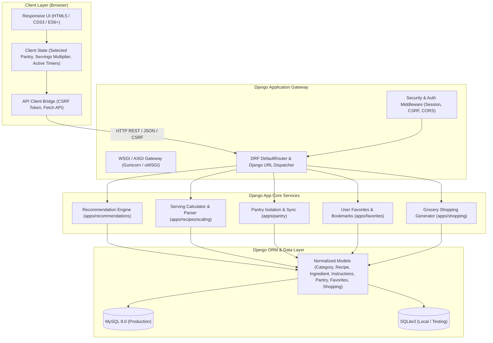
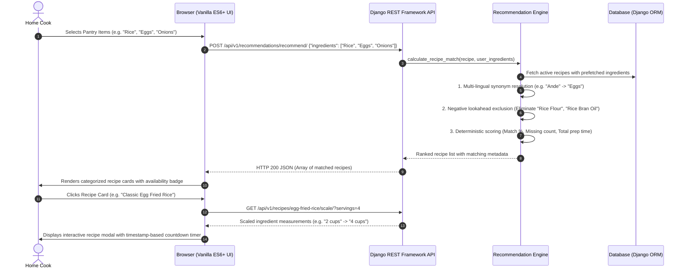

# AI Chef — System Architecture & Technical Design Document

## 1. Executive Summary

**AI Chef – Indian Homestyle Cooking & Recipe Platform** is a production-grade Python Full-Stack web application designed to solve domestic food waste and culinary decision fatigue across Indian households. The platform allows users to input or select ingredients available in their kitchen pantry and instantly discover authentic Indian recipes (spanning 10 culinary categories and 512 homestyle dishes) ranked by ingredient availability, completeness, and culinary relevance.

The system combines:
- A high-performance **Django 6.0+** and **Django REST Framework (DRF)** backend.
- A dual-database engine architecture supporting **MySQL 8.0+** for production and zero-config **SQLite3** for development and automated testing.
- A deterministic **Indian Culinary Recommendation Engine** equipped with multi-lingual synonym mapping (Hindi, Telugu, Tamil, Punjabi) and negative lookahead exclusion filters to eliminate false-positive ingredient matches.
- A real-time **Serving & Scaling Engine** supporting metric weights, mixed fractions, and decimals without cumulative drift.
- A user personalization subsystem providing session-isolated pantries, favorite recipe bookmarks, and multi-recipe grocery shopping list generation with ingredient aggregation.
- A responsive, accessible frontend built with HTML5, CSS3, ES6+ JavaScript, and Bootstrap 5 elements.

---

## 2. System Architecture Diagram

---

## 3. Modular Application Breakdown

The Django backend is structured into seven decoupled, single-responsibility applications under `apps/`:

| Application | Namespace / Responsibility | Key Models & Services |
| :--- | :--- | :--- |
| **`apps.accounts`** | Authentication, user profiles, session management | Django `User`, User Profile serializers, Auth APIs (`login`, `register`, `logout`, `me`) |
| **`apps.recipes`** | Recipe discovery, category indexing, ingredient amounts | `Category`, `Region`, `Cuisine`, `Recipe`, `RecipeIngredient`, `RecipeInstruction`, `scaling.py` |
| **`apps.ingredients`** | Ingredient taxonomy, regional aliases, substitutions | `Ingredient`, `IngredientSynonym`, `IngredientSubstitution` |
| **`apps.pantry`** | User-isolated pantries, session sync | `UserPantryItem`, session synchronization endpoint |
| **`apps.recommendations`** | Core recommendation engine, ranking, scoring | `calculate_recipe_match`, `ingredient_matches`, synonym dictionary |
| **`apps.favorites`** | User recipe bookmarks & saved recipes | `FavoriteRecipe`, toggle endpoints |
| **`apps.shopping`** | Grocery list generation & aggregation | `ShoppingList`, `ShoppingListItem`, multi-recipe generator |

---

## 4. End-to-End Data Flow

---

## 5. Recommendation Engine Architecture

The recommendation engine (`apps/recommendations/services.py`) is engineered to solve the core challenges of Indian cuisine data retrieval:

### 5.1 Multi-Lingual Synonym Resolution
Indian recipes use diverse regional nomenclature for identical staples. The engine maintains an indexed bidirectional synonym dictionary:
- **Hindi / Urdu**: *Aloo* (Potato), *Pyaz* (Onion), *Tamatar* (Tomato), *Adrak* (Ginger), *Lahsun* (Garlic), *Murgh* (Chicken), *Dahi* (Yogurt), *Jeera* (Cumin).
- **Telugu**: *Bangaradumpa* (Potato), *Ullipaya* (Onion), *Allam* (Ginger), *Vellulli* (Garlic), *Kodi Kura* (Chicken), *Perugu* (Curd).
- **Tamil**: *Urulaikizhangu* (Potato), *Vengayam* (Onion), *Thakkali* (Tomato), *Inji* (Ginger), *Poondu* (Garlic), *Thayir* (Curd).

### 5.2 Negative Lookahead Exclusion Filters
A frequent flaw in naive keyword matching is false-positive matches (e.g., matching "Rice" against "Rice Flour" or "Rice Bran Oil"). The engine enforces rigorous boundary rules:
- `"rice"` **does not** match `"rice flour"`, `"rice bran oil"`, `"flattened rice"`, or `"poha"`.
- `"egg"` or `"eggs"` **does not** match `"eggplant"` or `"deggi mirch"`.
- `"potato"` or `"potatoes"` **does not** match `"sweet potato"`.
- `"wheat"` **does not** match `"buckwheat"`.

### 5.3 Ranking Formula
Matches are ranked deterministically:
$$\text{Score} = (\text{User Matched Count} \times 1000) + \text{Match Percentage} - \text{Missing Count} - (\text{Prep Time} \times 0.1)$$
This ensures:
1. Recipes that utilize the highest count of user-selected ingredients appear first.
2. Complete dishes (100% ingredients available) outrank partial dishes.
3. Among dishes with identical coverage, faster preparation times are favored.

---

## 6. Serving Calculator & Scaling Engine

The scaling service (`apps/recipes/scaling.py`) uses single-pass regular expression tokenization and exact fraction arithmetic:
- **Integer scaling**: `2 cups` scaled $2\times \to$ `4 cups`.
- **Simple fraction scaling**: `1/2 tsp` scaled $2\times \to$ `1 tsp`; scaled $4\times \to$ `2 tsp`.
- **Mixed fraction scaling**: `1 1/2 cups` scaled $2\times \to$ `3 cups`; scaled $4\times \to$ `6 cups`.
- **Decimal scaling**: `1.5 tbsp` scaled $2\times \to$ `3 tbsp`.
- **Metric weight scaling**: `500g` scaled $2\times \to$ `1000g`; `250ml` scaled $2\times \to$ `500ml`.
- **Immutability**: Computations are performed on demand against immutable canonical base recipes without cumulative rounding drift.

---

## 7. RESTful API Catalog

Base URL: `/api/v1/`

| Endpoint | Method | Auth | Description |
| :--- | :---: | :---: | :--- |
| `/recipes/` | `GET` | Public | Paginated list of all 512 authentic recipes with filters (`category`, `dietary_type`, `search`) |
| `/recipes/{slug}/` | `GET` | Public | Full recipe detail including ingredients, amounts, instructions, and metadata |
| `/recipes/{slug}/scale/` | `GET` | Public | Dynamically scaled ingredient list (`?servings=4`) |
| `/recommendations/recommend/` | `POST` | Public | Core recommendation endpoint (`{"ingredients": ["Rice", "Eggs"], "dietary": "all"}`) |
| `/ingredients/` | `GET` | Public | Master ingredient taxonomy and regional search |
| `/auth/register/` | `POST` | Public | User registration (`{"username", "password", "email"}`) |
| `/auth/login/` | `POST` | Public | Session authentication login |
| `/auth/logout/` | `POST` | Session | Terminate session |
| `/auth/me/` | `GET` | Session | Current user status and profile metadata |
| `/pantry/` | `GET` | Session | User-isolated personal pantry items |
| `/pantry/sync_session_pantry/` | `POST` | Session | Bulk synchronize frontend pantry list into persistent database storage |
| `/favorites/` | `GET` | Session | User's bookmarked favorite recipes |
| `/favorites/toggle/` | `POST` | Session | Toggle favorite bookmark by `recipe_uid` |
| `/shopping/` | `GET` | Session | User's active shopping lists |
| `/shopping/generate_from_recipes/`| `POST` | Session | Automatically generate aggregated grocery list from selected recipes minus available pantry |
