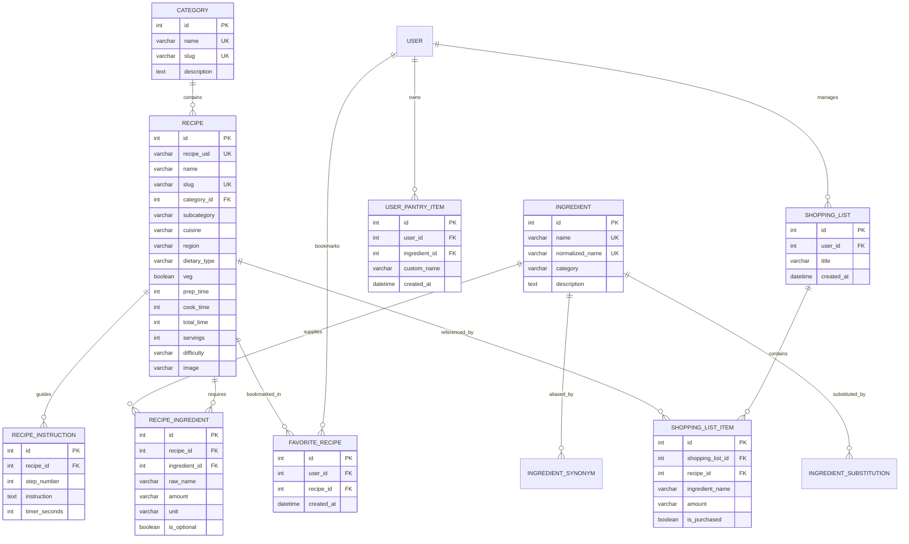

# AI Chef — Database Schema & Data Dictionary

## 1. Relational Database Overview

AI Chef is architected on a normalized relational data model designed to support 512+ authentic recipes, 900+ unique ingredients, regional culinary taxonomies, user pantry isolation, favorites, and dynamic shopping lists.

The platform supports a dual-engine architecture:
1. **MySQL 8.0+** (Production): Utilizes `InnoDB` storage engine, UTF8MB4 character collation, foreign key constraints, and B-tree composite indexing.
2. **SQLite3** (Development / Automated Testing): Zero-configuration embedded database utilizing full relational foreign key support (`PRAGMA foreign_keys = ON`).

---

## 2. Entity-Relationship (ER) Diagram

---

## 3. Data Dictionary & Table Specifications

### 3.1 `recipes_category`
Represents high-level culinary recipe groupings (e.g., *Biryani & Rice Dishes*, *Curries & Gravies*).

| Column | Type | Constraints | Description |
| :--- | :--- | :--- | :--- |
| `id` | `BIGINT` | `PRIMARY KEY, AUTO_INCREMENT` | Internal primary identifier |
| `name` | `VARCHAR(100)` | `NOT NULL, UNIQUE` | Unique category name |
| `slug` | `VARCHAR(100)` | `NOT NULL, UNIQUE, INDEX` | URL-friendly slug identifier |
| `description` | `LONGTEXT` | `NULLABLE` | Optional category description |
| `created_at` | `DATETIME` | `NOT NULL, DEFAULT NOW` | Timestamp of creation |

### 3.2 `recipes_recipe`
Stores canonical recipe metadata, preparation timings, classifications, and image paths.

| Column | Type | Constraints | Description |
| :--- | :--- | :--- | :--- |
| `id` | `BIGINT` | `PRIMARY KEY, AUTO_INCREMENT` | Internal primary identifier |
| `recipe_uid` | `VARCHAR(100)` | `NOT NULL, UNIQUE, INDEX` | Stable legacy UID (e.g. `classic-idli`) |
| `name` | `VARCHAR(200)` | `NOT NULL, INDEX` | Authentic dish name |
| `slug` | `VARCHAR(220)` | `NOT NULL, UNIQUE, INDEX` | SEO-friendly URL slug |
| `description` | `LONGTEXT` | `NULLABLE` | Dish description and background |
| `category_id` | `BIGINT` | `NOT NULL, FK -> recipes_category(id)` | Parent culinary category |
| `subcategory` | `VARCHAR(100)` | `NOT NULL, INDEX` | Dish type (e.g., `biryani`, `pulao`, `curry`) |
| `cuisine` | `VARCHAR(100)` | `NOT NULL, DEFAULT 'Homestyle'` | Regional style (e.g., `South Indian`, `North Indian`) |
| `region` | `VARCHAR(100)` | `NOT NULL, DEFAULT 'Pan-Indian'` | Geographic origin (e.g., `Hyderabad`, `Tamil Nadu`) |
| `dietary_type` | `VARCHAR(30)` | `NOT NULL, DEFAULT 'Vegetarian'` | `Vegetarian`, `Non-Vegetarian`, `Vegan` |
| `veg` | `TINYINT(1)` | `NOT NULL, DEFAULT 1, INDEX` | Boolean flag for fast vegetarian filtering |
| `prep_time` | `INT UNSIGNED`| `NOT NULL, DEFAULT 15, INDEX` | Preparation time in minutes |
| `cook_time` | `INT UNSIGNED`| `NOT NULL, DEFAULT 15` | Active cooking time in minutes |
| `total_time` | `INT UNSIGNED`| `NOT NULL, DEFAULT 30` | Total completion time in minutes |
| `servings` | `INT UNSIGNED`| `NOT NULL, DEFAULT 2` | Canonical serving portion size |
| `difficulty` | `VARCHAR(20)` | `NOT NULL, DEFAULT 'Easy'` | `Easy`, `Medium`, `Advanced` |
| `image` | `VARCHAR(300)` | `NOT NULL` | Local relative static asset path |
| `created_at` | `DATETIME` | `NOT NULL, DEFAULT NOW` | Record timestamp |
| `updated_at` | `DATETIME` | `NOT NULL, ON UPDATE NOW` | Modification timestamp |

**Indexes**:
- `recipes_rec_name_veg_idx`: Composite B-Tree index on `(name, veg)`
- `recipes_rec_cat_sub_idx`: Composite B-Tree index on `(category_id, subcategory)`
- `recipes_rec_prep_time_idx`: Single index on `(prep_time)`

### 3.3 `ingredients_ingredient`
Normalized master dictionary of all food items and pantry staples.

| Column | Type | Constraints | Description |
| :--- | :--- | :--- | :--- |
| `id` | `BIGINT` | `PRIMARY KEY, AUTO_INCREMENT` | Internal primary identifier |
| `name` | `VARCHAR(150)` | `NOT NULL, UNIQUE` | Standard English culinary name |
| `normalized_name`| `VARCHAR(150)`| `NOT NULL, UNIQUE, INDEX` | Lowercase trimmed token for O(1) matching |
| `category` | `VARCHAR(50)` | `NOT NULL, DEFAULT 'General'` | Taxonomy (e.g., `grain`, `spice`, `dairy`) |
| `description` | `LONGTEXT` | `NULLABLE` | Ingredient background |

### 3.4 `ingredients_ingredientsynonym`
Maps vernacular terms across regional languages to normalized ingredient entities.

| Column | Type | Constraints | Description |
| :--- | :--- | :--- | :--- |
| `id` | `BIGINT` | `PRIMARY KEY, AUTO_INCREMENT` | Internal primary identifier |
| `ingredient_id` | `BIGINT` | `NOT NULL, FK -> ingredients_ingredient(id)` | Canonical ingredient target |
| `synonym` | `VARCHAR(150)` | `NOT NULL, INDEX` | Vernacular synonym (e.g. `adrak`, `allam`) |
| `language` | `VARCHAR(50)` | `NOT NULL, DEFAULT 'Hindi'` | Language (`Hindi`, `Telugu`, `Tamil`, etc.) |

### 3.5 `recipes_recipeingredient`
Join entity associating a recipe with an ingredient and its portion.

| Column | Type | Constraints | Description |
| :--- | :--- | :--- | :--- |
| `id` | `BIGINT` | `PRIMARY KEY, AUTO_INCREMENT` | Internal primary identifier |
| `recipe_id` | `BIGINT` | `NOT NULL, FK -> recipes_recipe(id)` | Associated recipe (`ON DELETE CASCADE`) |
| `ingredient_id` | `BIGINT` | `NOT NULL, FK -> ingredients_ingredient(id)` | Associated ingredient (`ON DELETE CASCADE`) |
| `raw_name` | `VARCHAR(200)` | `NOT NULL` | Original text (e.g., `Aged Basmati Rice`) |
| `amount` | `VARCHAR(100)` | `NOT NULL` | Measurable quantity (e.g., `2 cups`, `500g`) |
| `unit` | `VARCHAR(50)` | `BLANK` | Unit of measure (`cups`, `tsp`, `grams`, etc.) |
| `is_optional` | `TINYINT(1)` | `NOT NULL, DEFAULT 0` | Optional garnish / spice indicator |

### 3.6 `recipes_recipeinstruction`
Sequential step-by-step cooking directions with step timer metadata.

| Column | Type | Constraints | Description |
| :--- | :--- | :--- | :--- |
| `id` | `BIGINT` | `PRIMARY KEY, AUTO_INCREMENT` | Internal primary identifier |
| `recipe_id` | `BIGINT` | `NOT NULL, FK -> recipes_recipe(id)` | Associated recipe (`ON DELETE CASCADE`) |
| `step_number` | `INT UNSIGNED`| `NOT NULL` | 1-indexed execution step |
| `instruction` | `LONGTEXT` | `NOT NULL` | Cooking instruction prose |
| `timer_seconds` | `INT UNSIGNED`| `NOT NULL, DEFAULT 0` | Optional step countdown timer in seconds |

**Constraints**:
- `UNIQUE(recipe_id, step_number)`: Enforces unique sequential step numbering per recipe.

### 3.7 `pantry_userpantryitem`
Personalized user kitchen inventory with strict user isolation.

| Column | Type | Constraints | Description |
| :--- | :--- | :--- | :--- |
| `id` | `BIGINT` | `PRIMARY KEY, AUTO_INCREMENT` | Internal primary identifier |
| `user_id` | `BIGINT` | `NOT NULL, FK -> auth_user(id)` | Owner user account (`ON DELETE CASCADE`) |
| `ingredient_id` | `BIGINT` | `NULLABLE, FK -> ingredients_ingredient(id)`| Linked master ingredient |
| `custom_name` | `VARCHAR(150)` | `BLANK` | Custom user-entered ingredient string |
| `created_at` | `DATETIME` | `NOT NULL, DEFAULT NOW` | Timestamp added |

**Constraints**:
- `UNIQUE(user_id, ingredient_id)`: Prevents duplicate ingredient entries for a single user.

### 3.8 `favorites_favoriterecipe`
User saved recipe bookmarks.

| Column | Type | Constraints | Description |
| :--- | :--- | :--- | :--- |
| `id` | `BIGINT` | `PRIMARY KEY, AUTO_INCREMENT` | Internal primary identifier |
| `user_id` | `BIGINT` | `NOT NULL, FK -> auth_user(id)` | Owner user account (`ON DELETE CASCADE`) |
| `recipe_id` | `BIGINT` | `NOT NULL, FK -> recipes_recipe(id)` | Saved recipe (`ON DELETE CASCADE`) |
| `created_at` | `DATETIME` | `NOT NULL, DEFAULT NOW` | Bookmark timestamp |

**Constraints**:
- `UNIQUE(user_id, recipe_id)`: A user can only bookmark a recipe once.

### 3.9 `shopping_shoppinglist` & `shopping_shoppinglistitem`
Multi-recipe shopping list items aggregated for weekly grocery planning.

| Column | Type | Constraints | Description |
| :--- | :--- | :--- | :--- |
| `id` | `BIGINT` | `PRIMARY KEY, AUTO_INCREMENT` | Internal primary identifier |
| `shopping_list_id`| `BIGINT`| `NOT NULL, FK -> shopping_shoppinglist(id)` | Parent shopping list |
| `recipe_id` | `BIGINT` | `NULLABLE, FK -> recipes_recipe(id)` | Originating recipe (optional) |
| `ingredient_name` | `VARCHAR(200)`| `NOT NULL` | Aggregated ingredient item |
| `amount` | `VARCHAR(100)` | `BLANK` | Recommended purchase quantity |
| `is_purchased` | `TINYINT(1)` | `NOT NULL, DEFAULT 0` | Checkbox item state |
